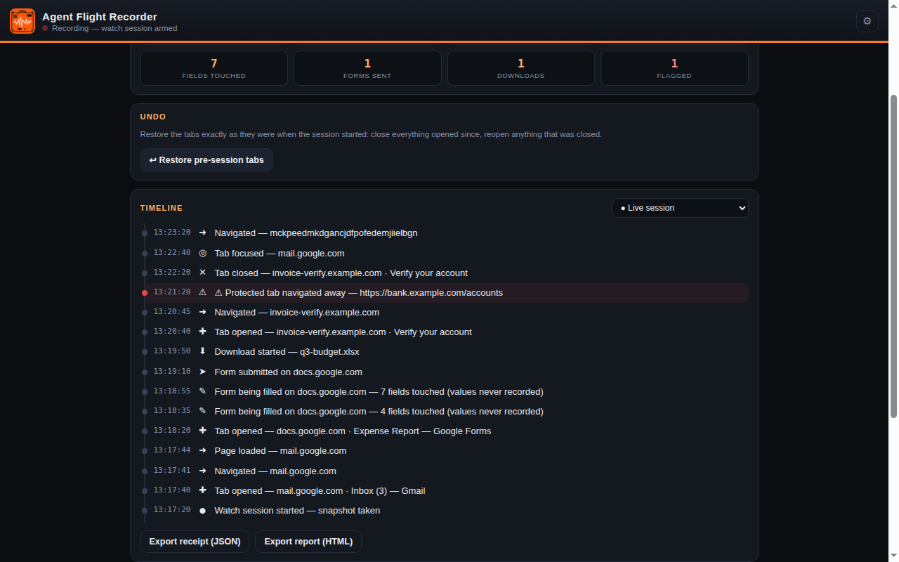
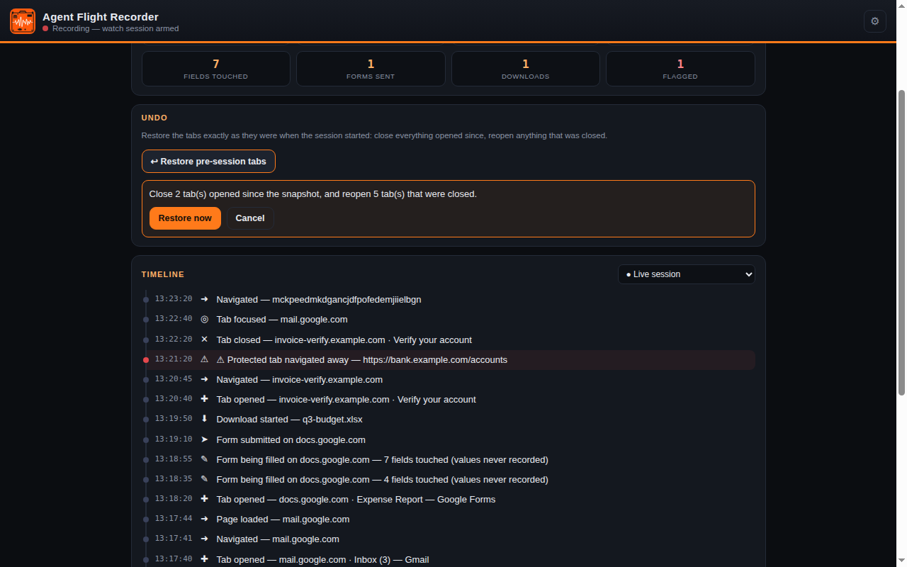
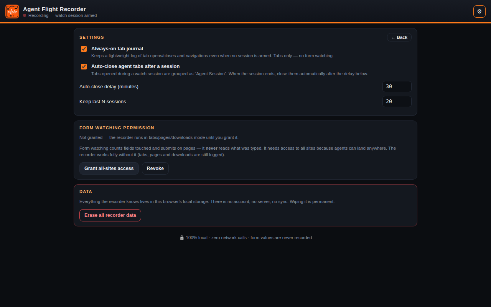

# Agent Flight Recorder


[](LICENSE)
[](https://developer.chrome.com/docs/extensions/mv3/)
[](#development)
[](#privacy)
[](#privacy)

**Your AI agent just worked in your browser for twenty minutes. What did it actually do?**

Agent Flight Recorder is the black box for browser AI agents — Claude in Chrome, ChatGPT, Comet, or any agent that drives your real Chrome. The agent's own summary is the agent grading its own homework. The Recorder is the independent witness: it logs every tab, page, form and download, and it can **undo the tab chaos** afterwards.

In Anthropic's own red-teaming, a fake employer email instructed Claude to delete messages "for security reasons" — and Claude complied, without confirmation. If that happened in your browser today, you would have no record of it. With the Recorder armed, you would have the full timeline.

> The referee can't be a player. This is the referee.

## Features

- **Watch Sessions** — Arm the recorder before an agent session. It snapshots every open tab (URL, title, pinned state) as the restore point, then records, in real time:
  - tabs opened, closed and focused
  - navigations and page loads (`webNavigation`)
  - downloads started
  - **optional** form activity: how many fields were touched and when a form was submitted — **never the values typed** (see Privacy)
  - warnings when a **Protected Tab** is navigated or closed
- **Flight Data header** — live session summary: duration, tabs opened/closed, navigations, fields touched, forms submitted, downloads, flagged events.
- **One-click Undo** — Restore closes every tab opened since the snapshot and reopens the ones that were closed, pinned state included. You see the exact plan ("Close 2 tabs, reopen 5 tabs") before anything happens.
- **Tab Warden** — Tabs opened during a session are auto-grouped into an orange **"Agent Session"** tab group. Optional TTL auto-close sweeps them away after the session ends.
- **Protected Tabs** — Mark your bank or inbox as protected. If anything navigates or closes it mid-session, the timeline flags it in red.
- **Exportable receipts** — Every session exports as JSON or as a standalone, printable HTML report: the evidence file you can send to a client, a boss, or a support ticket.
- **Always-on tab journal** (optional) — a lightweight tabs-only log outside watch sessions.
- **Retention controls** — keep the last N sessions (default 20), and a one-click erase-everything button.

## How it works

1. Open the side panel and hit **Start watch session** — optionally ticking *form activity*.
2. Let your agent work. Everything is written to `chrome.storage.local` on your machine.
3. End the session. Review the timeline, export the receipt, and hit **Restore** if the agent left your tabs in a mess.

Form watching is **opt-in twice**: you tick the box, and Chrome asks you to grant the all-sites permission. The form observer is not even registered until that grant exists, it only ever counts fields (it never reads a value), and revoking the permission unregisters it instantly.

## Privacy

- **Zero data collection.** No accounts, no analytics, no telemetry, no servers.
- **Zero network calls.** The extension makes none, ever. Verify it in DevTools.
- **Form values are never recorded** — not stored, not logged, not exported. Only field *counts* and submit events.
- Everything lives in your browser's local storage, under your control, erasable in one click.
- At install time the extension has **no access to any website** (`chrome.permissions.getAll()` → `origins: []`). Site access exists only while you grant it, for form watching only.

## Permissions — and why each one exists

| Permission | Why |
| --- | --- |
| `tabs` | Snapshot tabs at arm time; record opens/closes; restore them on Undo. |
| `webNavigation` | Record navigations and page loads — the core of the timeline. |
| `downloads` | Record downloads an agent starts (name + origin only). |
| `storage` | Keep sessions, settings and receipts locally. Nothing leaves the device. |
| `sidePanel` | The recorder UI lives in Chrome's side panel. |
| `tabGroups` | Group session tabs into the "Agent Session" group (Tab Warden). |
| `alarms` | Power the optional TTL auto-close after a session ends. |
| `scripting` | Inject the form-activity counter **only** where you have granted site access. By itself it grants access to nothing. |
| *(optional)* `<all_urls>` host access | Requested in context, only if you enable form watching. Revocable any time in Settings. |

No `debugger` permission. No always-on host access. Compare the install prompt with your agent's fifteen permissions.

## Install

**From the Chrome Web Store:** coming soon.

**Load unpacked (developer mode):**

1. Download or clone this repo.
2. Open `chrome://extensions`, enable **Developer mode**.
3. **Load unpacked** → select the repo folder.
4. Click the toolbar icon to open the side panel.

## Development

Vanilla JS, Manifest V3, no build step. The pure logic (snapshot diffing, restore planning, summarization, retention, receipt generation) lives in `src/lib/logic.js` and is fully unit-tested in Node:

```sh
node --test tests/logic.test.mjs   # 18 tests
```

## Screenshots

| Timeline mid-session | Restore confirmation | Settings |
| --- | --- | --- |
|  |  |  |

## Roadmap

- **No-Go Zones (Pro):** a user-set policy layer — protected sites and actions enforced across *every* agent, not just recorded.
- Shareable receipt links.
- Firefox port.

## License

MIT — see [LICENSE](LICENSE).
